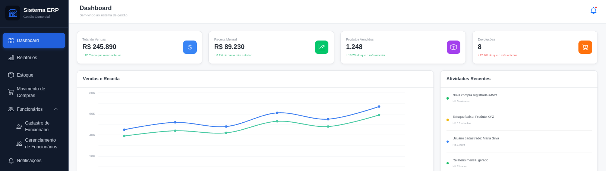

# SIVAD

<p align="center">
  
</p>

<p align="center">
  Sistema web de gestão comercial para pedidos, compras, estoque, usuários e relatórios.
</p>

## Sobre o projeto

O SIVAD organiza operações de vendas e administração em uma aplicação web. Administradores gerenciam funcionários, produtos, compras de estoque e devoluções. Funcionários registram pedidos, consultam a disponibilidade de produtos e finalizam pedidos pelo sistema.

Os totais dos pedidos são calculados no servidor com base nos preços armazenados no banco de dados e nas quantidades informadas. A aplicação não realiza pagamentos: o pagamento é tratado fora do sistema.

## Funcionalidades

### Autenticação e usuários

- Login de administradores e funcionários por UID numérico e senha.
- Sessão com controle de acesso por perfil.
- Cadastro, edição e desativação de funcionários por administrador.
- Solicitação de recuperação de senha para análise administrativa.
- Senhas armazenadas como hash com salt; não são persistidas em texto simples.

### Pedidos

- Inclusão de produtos por seleção ou por código de barras.
- Consulta de disponibilidade de estoque durante o registro do pedido.
- Cálculo do total no servidor usando os preços vigentes no banco e as quantidades.
- Resumo do pedido antes da finalização.
- Baixa do estoque ao finalizar o pedido.
- Reposição de estoque ao cancelar um pedido finalizado.

### Produtos e estoque

- Cadastro e edição de produtos, incluindo código de barras.
- Consulta de quantidades disponíveis.
- Registro de compras de estoque com fornecedor, produtos e quantidades.
- Registro de devoluções e atualização do estoque.
- Alertas para produtos com estoque baixo.

### Dashboard e relatórios

- Indicadores e gráficos de vendas e compras.
- Relatórios diários, mensais e anuais.
- Consulta de devoluções e fluxo de caixa.
- Central de notificações com alertas de estoque e solicitações pendentes de recuperação de senha.

## Tecnologias

- C# e .NET 10
- ASP.NET Core MVC e Razor Views
- SQL Server
- `Microsoft.Data.SqlClient` para acesso ao banco de dados
- HTML, CSS e JavaScript
- Bootstrap 5 e Bootstrap Icons
- Google Charts para gráficos
- Padrões de arquitetura MVC e Repository
- Padrão Strategy para organização de cálculos

## Arquitetura

A aplicação segue a separação MVC:

- **Models**: entidades e modelos usados pelas telas.
- **Views**: páginas Razor apresentadas ao usuário.
- **Controllers**: recebem as solicitações, aplicam o fluxo da aplicação e retornam as telas ou redirecionamentos.
- **Repositories**: concentram as consultas e operações SQL.

A interface `IRepositorioSIVAD` separa os controladores da implementação SQL. `DataConnection` centraliza a criação de conexões com o SQL Server. A pasta `Strategies` contém estratégias de cálculo para pedidos e compras.

## Estrutura do projeto

```text
SIVAD/
├── Controllers/       # Controladores MVC
├── Database/          # Scripts de criação, atualização e objetos SQL
├── Filtros/           # Filtros de sessão e autorização
├── Infrastructure/    # Componentes de infraestrutura da aplicação
├── Models/            # Entidades e ViewModels
├── Repositories/      # Interface e implementação de acesso a dados
├── Seguranca/         # Recursos relacionados à proteção de senhas
├── Strategies/        # Estratégias de cálculo
├── Views/             # Telas Razor
├── wwwroot/           # CSS e JavaScript
├── assets/            # Imagens do projeto
├── SIVAD.csproj
└── SIVAD.sln
