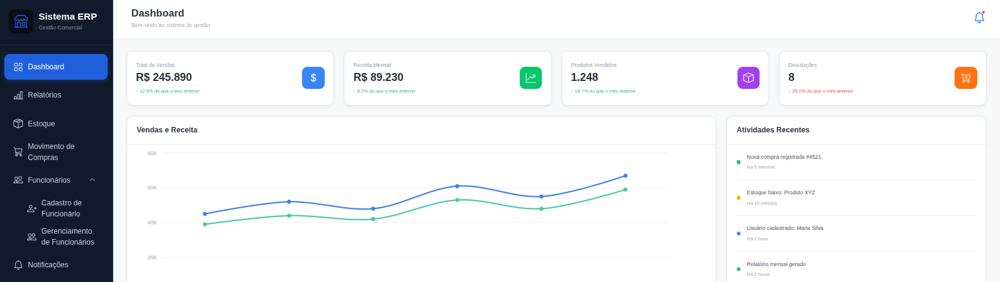

# SIVAD

<p align="center">
  
</p>

<p align="center">
  Sistema web de gestão comercial para pedidos, compras, estoque, usuários e relatórios.
</p>

## Sobre o projeto

O SIVAD organiza operações de vendas e administração em uma aplicação web. Administradores gerenciam funcionários, produtos, compras de estoque e devoluções. Funcionários registram pedidos, consultam a disponibilidade de produtos e finalizam pedidos pelo sistema.

Os totais dos pedidos são calculados no servidor com base nos preços armazenados no banco de dados e nas quantidades informadas. A aplicação não realiza pagamentos: o pagamento é tratado fora do sistema.

## Funcionalidades

### Autenticação e usuários

- Login de administradores e funcionários por UID numérico e senha.
- Sessão com controle de acesso por perfil.
- Cadastro, edição e desativação de funcionários por administrador.
- Solicitação de recuperação de senha para análise administrativa.
- Senhas armazenadas como hash com salt; não são persistidas em texto simples.

### Pedidos

- Inclusão de produtos por seleção ou por código de barras.
- Consulta de disponibilidade de estoque durante o registro do pedido.
- Cálculo do total no servidor usando os preços vigentes no banco e as quantidades.
- Resumo do pedido antes da finalização.
- Baixa do estoque ao finalizar o pedido.
- Reposição de estoque ao cancelar um pedido finalizado.

### Produtos e estoque

- Cadastro e edição de produtos, incluindo código de barras.
- Consulta de quantidades disponíveis.
- Registro de compras de estoque com fornecedor, produtos e quantidades.
- Registro de devoluções e atualização do estoque.
- Alertas para produtos com estoque baixo.

### Dashboard e relatórios

- Indicadores e gráficos de vendas e compras.
- Relatórios diários, mensais e anuais.
- Consulta de devoluções e fluxo de caixa.
- Central de notificações com alertas de estoque e solicitações pendentes de recuperação de senha.

## Tecnologias

- C# e .NET 10
- ASP.NET Core MVC e Razor Views
- SQL Server
- `Microsoft.Data.SqlClient` para acesso ao banco de dados
- HTML, CSS e JavaScript
- Bootstrap 5 e Bootstrap Icons
- Google Charts para gráficos
- Padrões de arquitetura MVC e Repository
- Padrão Strategy para organização de cálculos

## Guia de execução local

### Pré-requisitos

- Windows com o serviço da instância do SQL Server instalado e iniciado. O SQL Server Express também pode ser usado.
- Uma instância do SQL Server e uma forma de autenticação configurada. Para usar usuário e senha SQL, habilite **SQL Server Authentication** (modo misto: Windows e SQL Server) e use uma conta que tenha permissões para criar/alterar o banco durante a instalação. Os scripts de criação podem exigir privilégios de administrador do SQL Server.
- SQL Server Management Studio (SSMS), para conectar ao SQL Server e executar os arquivos `.sql` da pasta `Database`.
- .NET 10 SDK instalado. No PowerShell, `dotnet --version` deve retornar uma versão `10.x`.
- Os arquivos do projeto extraídos em uma pasta local. Git só é necessário se o projeto for clonado.

### 1. Obter o projeto

Extraia o ZIP do projeto ou clone o repositório. Abra o PowerShell na pasta do projeto, a mesma que contém `SIVAD.sln` e `SIVAD.csproj`:

```powershell
git clone <URL_DO_REPOSITORIO>
cd Projeto-Interdisciplinar
```

Se recebeu um ZIP, não execute o `git clone`: extraia o arquivo e use `cd` para entrar na pasta extraída que contém esses arquivos.

### 2. Iniciar o SQL Server e identificar a instância

Confirme que o serviço do SQL Server está em execução. No Windows, a instância pode ser verificada no **SQL Server Configuration Manager** ou na lista de serviços do Windows. Exemplos de nomes de servidor usados no SSMS e na string de conexão:

- Instância padrão ouvindo na porta 1433: `localhost,1433`.
- SQL Server Express com instância nomeada: normalmente `localhost\SQLEXPRESS` (confirme o nome instalado).
- Instância local padrão sem porta explicitada: frequentemente `localhost`.

No SSMS, informe o nome da instância em **Server name** e escolha o método de autenticação que pretende usar. Com **SQL Server Authentication**, entre com o login e a senha SQL. Se essa opção não estiver habilitada, um administrador da instância precisa habilitar **SQL Server and Windows Authentication mode** nas propriedades de segurança do servidor e reiniciar o serviço. Não altere isso sem a autorização de quem administra a máquina/instância.

### 3. Criar e preparar o banco

No SSMS, conecte-se à instância correta com uma conta que tenha permissão para criar o banco. Abra cada arquivo em `Database` e execute-o separadamente com **Execute** (ou `F5`), aguardando a conclusão antes de seguir. Para uma instalação nova, use esta ordem:

1. `Database/Banco.sql` — cria `SQLVendas2026` e as tabelas iniciais. Use somente quando o banco ainda não existe e está sendo criado do zero; as tabelas não são recriadas de forma idempotente.
2. `Database/AtualizarBanco.sql` — adiciona campos e tabelas complementares usados pela versão atual. Confira no início do resultado que o banco selecionado é `SQLVendas2026`.
3. `Database/Insercoes.sql` — **opcional**, carrega dados demonstrativos para a apresentação. Rode depois da criação/atualização e antes das views.
4. `Database/Views.sql` — cria as views consultadas pela aplicação; é necessário para o funcionamento dos relatórios e consultas que dependem delas.
5. `Database/Procedures.sql` — **opcional para iniciar o SIVAD**. Instala procedures de apoio/documentação; o fluxo MVC da aplicação executa operações pelo Repository.

Os scripts de diagnóstico e de redefinição de credenciais também são auxiliares, não fazem parte da sequência normal de instalação. `Database/RedefinirCredenciaisDemonstracao.sql` só deve ser usado em banco local de demonstração e depois de `Insercoes.sql`; ele redefine as credenciais demonstrativas.

> **Atenção:** se `SQLVendas2026` já existe, não execute novamente `Banco.sql`. Não rode scripts de demonstração ou redefinição em um banco com dados reais. Em caso de banco existente, faça backup e confirme com a equipe qual atualização é adequada antes de executar scripts.

### 4. Configurar a string de conexão

O SIVAD lê `ConnectionStrings:DefaultConnection` em `appsettings.json`. Substitua servidor, banco, usuário e senha pelos valores usados no SSMS. A string usa ponto e vírgula entre os campos.

**SQL Server Authentication** (usuário e senha SQL; funciona no Windows e no Linux):

```text
Server=NOME-DO-PC\SQLEXPRESS;Database=SQLVendas2026;User Id=USUARIO_SQL;Password=SENHA_SQL;TrustServerCertificate=True;
```

Em `appsettings.json`, a entrada fica dentro de `ConnectionStrings`:

```json
"ConnectionStrings": {
  "DefaultConnection": "Server=NOME-DO-PC\\SQLEXPRESS;Database=SQLVendas2026;User Id=USUARIO_SQL;Password=SENHA_SQL;TrustServerCertificate=True;"
}
```

**Sobre as barras:** no JSON, escreva duas barras (`\\`) para representar uma barra no nome da instância. Em uma variável de ambiente/terminal, use uma barra (`\`), por exemplo `NOME-DO-PC\SQLEXPRESS`. Para uma porta TCP, use `Server=NOME-DO-PC,1433`.

**Autenticação integrada do Windows** (sem `User Id` ou `Password`; usa a conta do Windows que executa o SIVAD):

```text
Server=NOME-DO-PC\SQLEXPRESS;Database=SQLVendas2026;Integrated Security=True;TrustServerCertificate=True;
```

No Linux, use SQL Authentication, a menos que Kerberos já esteja configurado para a aplicação; `Integrated Security=True` não usa automaticamente a conta local do Linux.

Se preferir não editar o JSON, defina a variável de ambiente no mesmo terminal em que iniciará o programa.

PowerShell:

```powershell
$env:ConnectionStrings__DefaultConnection = "Server=NOME-DO-PC\SQLEXPRESS;Database=SQLVendas2026;User Id=USUARIO_SQL;Password=SENHA_SQL;TrustServerCertificate=True;"
```

Bash:

```bash
export ConnectionStrings__DefaultConnection='Server=NOME-DO-PC,1433;Database=SQLVendas2026;User Id=USUARIO_SQL;Password=SENHA_SQL;TrustServerCertificate=True;'
```

Não misture autenticação SQL e integrada, nem compartilhe uma senha real.

### 5. Preparar o primeiro acesso

Antes de iniciar, escolha uma das opções:

**Primeiro administrador:** antes de iniciar, defina `Autenticacao__ChaveConfiguracaoInicial` no terminal em que executará o programa. Não é necessário inserir previamente a pessoa ou o e-mail no banco; o formulário criará o cadastro inicial.

PowerShell: `$env:Autenticacao__ChaveConfiguracaoInicial = "SUA_CHAVE"`  
Bash: `export Autenticacao__ChaveConfiguracaoInicial='SUA_CHAVE'`

**Dados demonstrativos:** depois de executar `Database/Insercoes.sql`, rode `Database/RedefinirCredenciaisDemonstracao.sql` no SSMS antes de iniciar o programa. O script restaura os e-mails, perfis e senhas demonstrativas de Ana (administradora) e João (funcionário), reativa essas contas e exibe os UIDs. Use apenas em uma base local de demonstração: ele altera credenciais existentes.

> A carga `Insercoes.sql` já cria credenciais demonstrativas. Portanto, escolha a configuração manual **ou** o acesso demonstrativo; para a apresentação, use os dados demonstrativos.

### 6. Restaurar, compilar e iniciar o programa

Na pasta que contém `SIVAD.csproj`, execute no PowerShell (Windows) ou no Bash (Linux):

```text
dotnet restore
dotnet build
dotnet run --launch-profile http
```

O perfil `http` abre `http://localhost:5129`. Mantenha o terminal e o SQL Server ativos; encerre com `Ctrl+C`. Também há um perfil HTTPS em `https://localhost:7095`.

### 7. Primeiro acesso ao sistema

**Primeiro administrador:** na tela de Login, clique em **Configurar o primeiro administrador** e informe nome, CPF, e-mail, chave local e senha. O sistema cria os registros em `Pessoas`, `Administradores` e `CredenciaisAcesso` numa única transação; não exige cadastro prévio. O banco gera o UID numérico, que será exibido após a conclusão. Guarde-o para os próximos logins. A chave de configuração é diferente da senha SQL e da senha da conta.

**Dados demonstrativos:** use o UID exibido pelo script e a senha demonstrativa correspondente. O login pede o UID numérico, não o e-mail.

### Solução rápida de problemas

- **Erro de autenticação do SQL Server:** confirme o método escolhido no SSMS e na string (SQL Authentication ou Windows Authentication) e as permissões da conta.
- **Erro de conexão/servidor:** confirme que o serviço está iniciado e que `Server=` corresponde ao nome da instância ou à porta usada tanto no SSMS quanto na variável de ambiente.
- **Erro de tabela ou coluna ausente:** em uma instalação nova, confirme que executou `Banco.sql` e `AtualizarBanco.sql`; se o erro mencionar uma view, confira `Views.sql`. Não reaplique `Banco.sql` em um banco existente.
- **O programa aponta para o banco errado:** confira `Database=SQLVendas2026` na string e certifique-se de que os scripts foram executados na mesma instância indicada por `Server=`.
- **Mudou a string e nada aconteceu:** defina novamente `$env:ConnectionStrings__DefaultConnection` na mesma janela e reinicie o `dotnet run`.
- **Login não funciona:** confirme que o usuário tem credencial ativa e use o UID numérico, não o e-mail. Para a demonstração, consulte os UIDs retornados pelo script de redefinição.
- **Comando `dotnet` não reconhecido:** instale o .NET 10 SDK e reabra o PowerShell.

## Arquitetura

A aplicação segue a separação MVC:

- **Models**: entidades e modelos usados pelas telas.
- **Views**: páginas Razor apresentadas ao usuário.
- **Controllers**: recebem as solicitações, aplicam o fluxo da aplicação e retornam as telas ou redirecionamentos.
- **Repositories**: concentram as consultas e operações SQL.

A interface `IRepositorioSIVAD` separa os controladores da implementação SQL. `DataConnection` centraliza a criação de conexões com o SQL Server. A pasta `Strategies` contém estratégias de cálculo para pedidos e compras.

## Estrutura do projeto

```text
SIVAD/
├── Controllers/       # Controladores MVC
├── Database/          # Scripts de criação, atualização e objetos SQL
├── Filtros/           # Filtros de sessão e autorização
├── Infrastructure/    # Componentes de infraestrutura da aplicação
├── Models/            # Entidades e ViewModels
├── Repositories/      # Interface e implementação de acesso a dados
├── Seguranca/         # Recursos relacionados à proteção de senhas
├── Strategies/        # Estratégias de cálculo
├── Views/             # Telas Razor
├── wwwroot/           # CSS e JavaScript
├── assets/            # Imagens do projeto
├── SIVAD.csproj
└── SIVAD.sln
